# URL Shortener on AWS

[](https://github.com/RamlaHussain458/url-shortener-aws/actions/workflows/ci.yml)
[](https://github.com/RamlaHussain458/url-shortener-aws/releases)


[](LICENSE)

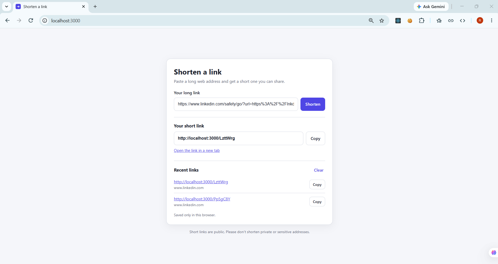

A secure URL shortener, built and deployed end to end: a Spring Boot API, a React web app, a MySQL database, AWS infrastructure defined in Terraform, a GitHub Actions pipeline that tests and deploys without stored AWS keys, and CloudWatch monitoring.

The application itself is deliberately small. The point of the project is the full lifecycle around it: design, security, tests, containers, infrastructure as code, CI/CD and monitoring, all within a student budget.

> **About the live demo.** The server and database are created only when I need them and destroyed afterwards to protect my AWS credits, so there is no permanent public URL. The [Screenshots](#screenshots) section shows the real deployment, and you can run the whole stack locally in a few minutes with Docker.

## Table of contents

- [Problem statement](#problem-statement)
- [Features](#features)
- [Architecture](#architecture)
- [Screenshots](#screenshots)
- [Tech stack](#tech-stack)
- [Getting started (local)](#getting-started-local)
- [Deploying to AWS](#deploying-to-aws)
- [API reference](#api-reference)
- [Configuration](#configuration)
- [Testing](#testing)
- [Monitoring](#monitoring)
- [Design decisions](#design-decisions)
- [Security](#security)
- [Problems I ran into](#problems-i-ran-into)
- [Project structure](#project-structure)
- [Known limitations](#known-limitations)
- [Roadmap](#roadmap)
- [What I would improve for production](#what-i-would-improve-for-production)

## Problem statement

Long links are awkward to share. A URL shortener turns them into short ones, but a careless one is easy to abuse: it can redirect people to internal addresses, hand out guessable links, or fall over under a flood of requests.

This project builds one that is safe by default, then takes it through everything a real service needs: automated tests, repeatable infrastructure, a deployment pipeline and monitoring. Every important choice is written down, so each decision has a short record in [`docs/adr`](docs/adr).

## Features

- Create a short link from any public HTTP or HTTPS URL, from the web app or the API
- Fast redirects, with an in-memory LRU cache in front of the database
- Unguessable 7-character Base62 codes (about 3.5 trillion combinations)
- Safe by default: URL validation, per-IP rate limiting, security headers and deny-by-default access rules
- Consistent JSON error responses (RFC 9457 problem details)
- Database schema versioned with Flyway migrations
- Unit and integration tests, run against a real MySQL database with Testcontainers
- Hardened containers: multi-stage builds, non-root users, dropped Linux capabilities, and a read-only filesystem for the API container
- Infrastructure as code with Terraform, including remote state in S3
- Deployment from GitHub Actions using OpenID Connect (no AWS access keys stored in GitHub)
- CloudWatch logs, alarms with email alerts and a dashboard
- Copy button with a fallback for browsers where the modern Clipboard API is unavailable

## Architecture

### AWS deployment

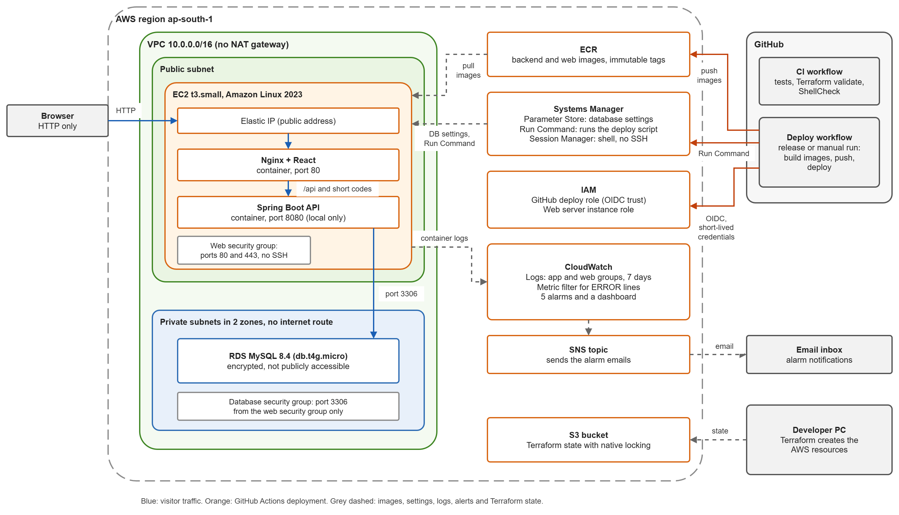

The editable source is [`docs/architecture.drawio`](docs/architecture.drawio). A full write-up of the components, deploy flow, security design and limitations is in [`docs/aws-deployment.md`](docs/aws-deployment.md).

There is no NAT gateway, no load balancer and no SSH port. Shell access uses Session Manager. The reasons are in [ADR 0003](docs/adr/0003-free-tier-aws-architecture.md) and [ADR 0007](docs/adr/0007-network-design.md).

### CI/CD pipeline

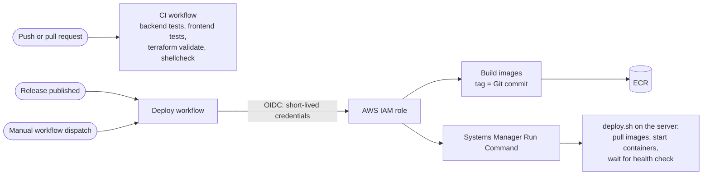

### Inside the application

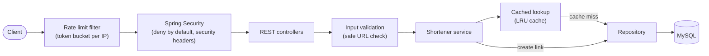

### Creating and following a link

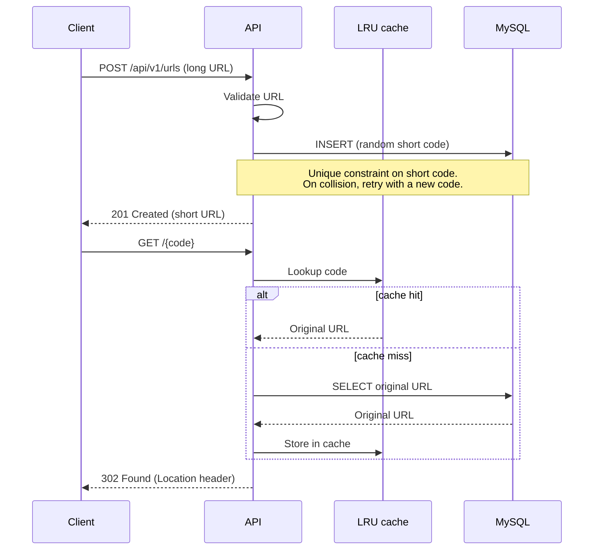

## Screenshots

These come from real deployments of this project on AWS (v0.2.0 and v0.3.0). Account identifiers, IP addresses and test links are covered with black boxes.

**The web app running on the EC2 instance.** The browser shows "Not secure" because the site is served over HTTP only (see [Known limitations](#known-limitations)).

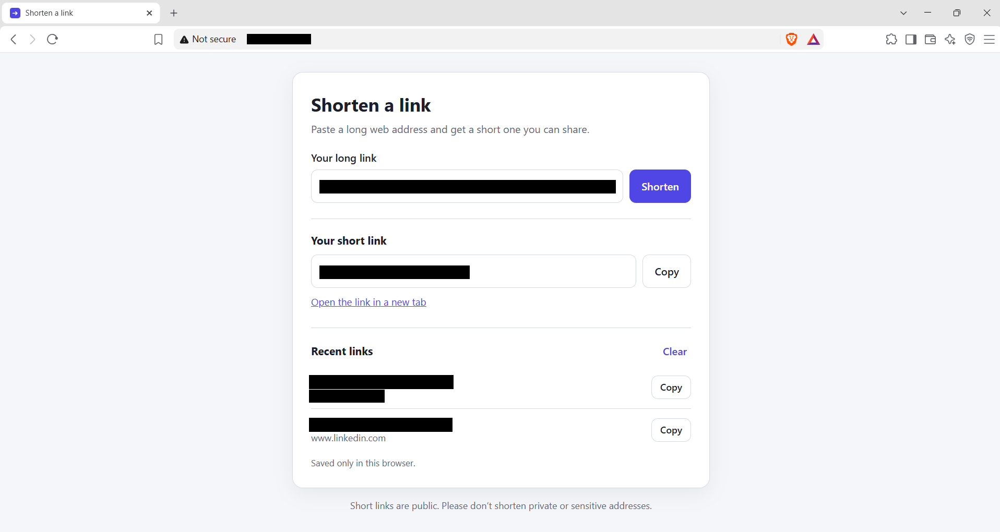

**A successful run of the Deploy workflow for v0.2.0.** The job builds both images, pushes them to ECR and deploys through Systems Manager.

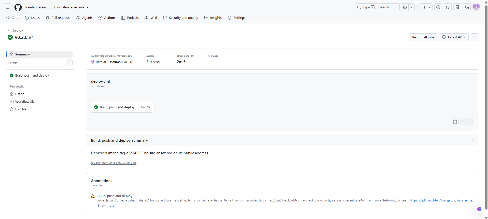

**The VPC resource map.** Two public and two private subnets across two availability zones, one internet gateway and no NAT gateway.

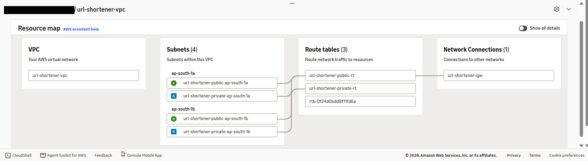

**The CloudWatch dashboard** with server CPU and network, database CPU and connections, the application error count and the latest log lines.

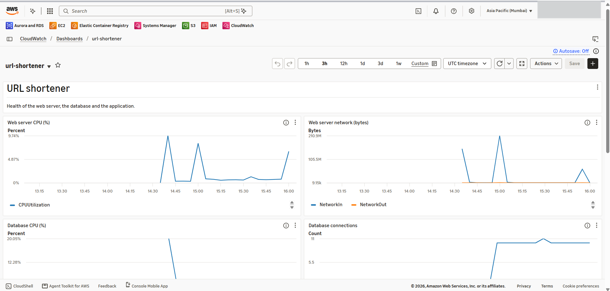

**The alarms overview.** All five alarms are in the OK state.

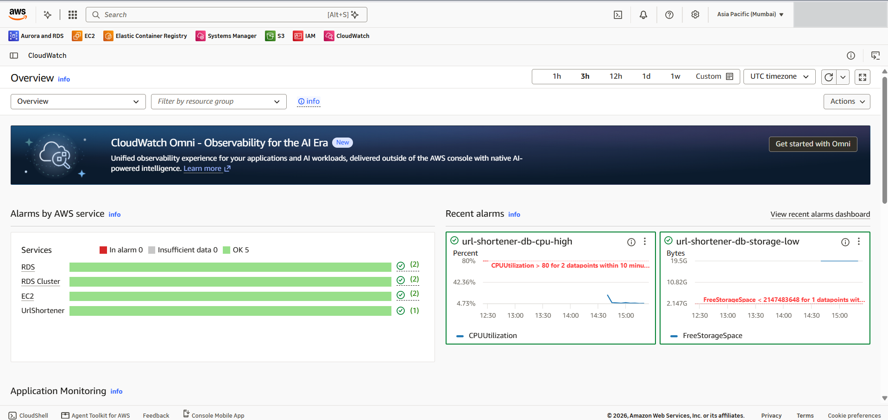

**Container logs in CloudWatch.** These are the Nginx access log lines for the web container, delivered by the Docker `awslogs` driver.

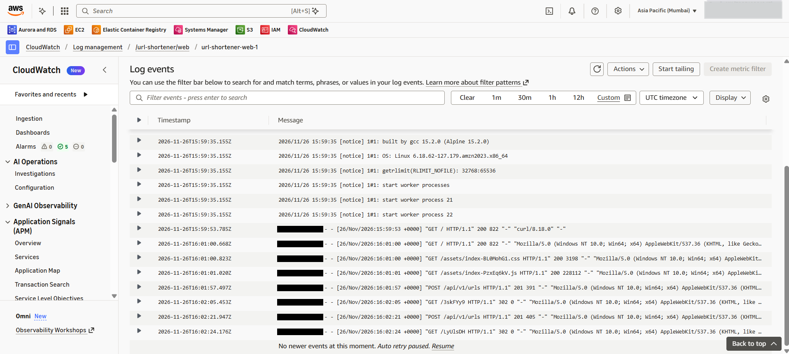

**An alarm email delivered through SNS.** I triggered the application error alarm by hand to test the notification path.

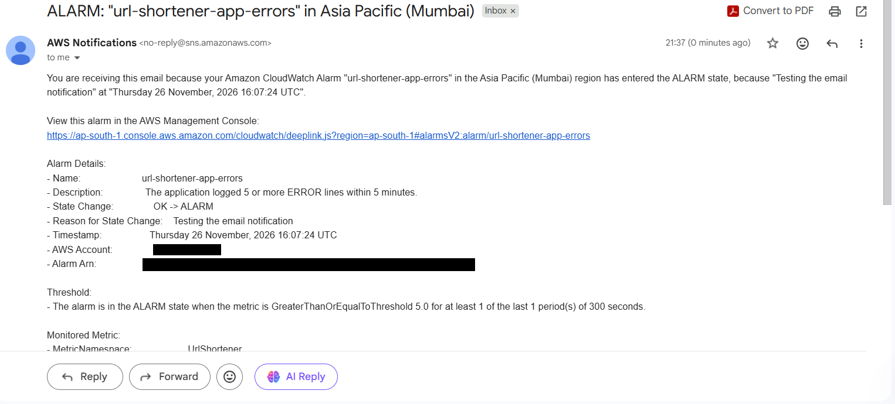

## Tech stack

| Area | Technology |
|---|---|
| Backend | Java 21, Spring Boot 4.0, Spring Security, Bean Validation |
| Frontend | React 19, Vite, served by Nginx |
| Database | MySQL 8.4 (Amazon RDS in the cloud), schema managed with Flyway |
| Containers | Docker (multi-stage builds), Docker Compose |
| Infrastructure | Terraform: VPC, subnets, security groups, EC2, RDS, ECR, IAM, S3 remote state |
| CI/CD | GitHub Actions, OIDC federation to AWS, Systems Manager Run Command |
| Secrets | Terraform-generated database password stored in SSM Parameter Store |
| Monitoring | CloudWatch Logs, metrics, alarms and dashboard, SNS email alerts |
| Testing | JUnit 5, Mockito, AssertJ, Testcontainers, Vitest |

## Getting started (local)

### Prerequisites

- Docker Desktop (or Docker Engine with the Compose plugin)
- Git
- JDK 21, Maven and Node.js 20 or newer, only if you want to run the backend or frontend outside Docker

### 1. Clone the repository

```bash
git clone https://github.com/RamlaHussain458/url-shortener-aws.git
cd url-shortener-aws
```

### 2. Create your environment file

In the repository root (next to `docker-compose.yml`), create a file named `.env`:

```properties
DB_NAME=urlshortener
DB_USER=urlshortener
DB_PASSWORD=change-me
DB_ROOT_PASSWORD=change-me-too
```

Change both passwords. Use only letters, numbers and dashes. The `.env` file is ignored by Git and must never be committed.

### 3. Start everything

```bash
docker compose up --build
```

Open [http://localhost:3000](http://localhost:3000), paste a long link and shorten it.

The web container (Nginx) serves the React app and forwards `/api` calls and short codes to the API. The API itself is published only on `127.0.0.1:8080`, so it cannot be reached directly from other machines.

Stop with:

```bash
docker compose down
```

Add `-v` to also delete the database data.

### 4. Try the API directly

```bash
curl -X POST http://localhost:3000/api/v1/urls \
  -H "Content-Type: application/json" \
  -d '{"url":"https://example.com/hello"}'
```

In PowerShell:

```powershell
Invoke-RestMethod -Method Post -Uri http://localhost:3000/api/v1/urls -ContentType "application/json" -Body '{"url":"https://example.com/hello"}'
```

Example response:

```json
{
  "shortCode": "aB3dE9x",
  "shortUrl": "http://localhost:3000/aB3dE9x",
  "originalUrl": "https://example.com/hello"
}
```

### Running for development

Start only the database. It is published on port 3307 so it does not clash with a MySQL installed on your machine:

```bash
docker compose up -d db
```

Run the backend from your IDE (`UrlShortenerApplication`) or with:

```bash
cd backend
mvn spring-boot:run
```

It reads the same `.env` file from the repository root.

Run the frontend with hot reload:

```bash
cd web
npm install
npm run dev
```

The Vite dev server ([http://localhost:5173](http://localhost:5173)) proxies API calls to the backend on port 8080.

## Deploying to AWS

The full runbook is in [`docs/deployment.md`](docs/deployment.md), the design write-up is in [`docs/aws-deployment.md`](docs/aws-deployment.md) and the Terraform setup is in [`infra/README.md`](infra/README.md).

### One-time setup

1. Install Terraform 1.11 or newer and the AWS CLI v2, and configure an AWS profile.
2. Create the S3 bucket for Terraform state (commands in `infra/README.md`) and put its name in `infra/backend.tf`.
3. Create `infra/terraform.tfvars` with your alert email (`alert_email = "you@example.com"`). This file is not committed.
4. If you fork the repository, change `github_repository` and `github_oidc_subject_repo` in `infra/variables.tf` to your own repository.
5. Run `terraform init` and `terraform apply` in `infra/`.
6. Add the repository secret `AWS_DEPLOY_ROLE_ARN` on GitHub, using the value of `terraform output github_deploy_role_arn`.

### Every deployment

1. Make sure the infrastructure exists. If the server and database were destroyed to save money, run `terraform apply` in `infra/` to recreate them, then wait until the EC2 instance is running and registered with Systems Manager.
2. Publish a GitHub release, or trigger the **Deploy** workflow manually from the Actions tab using the `main` branch.
3. The workflow signs in to AWS with OIDC and short-lived credentials, builds the backend and frontend images, tags them with the Git commit, and pushes them to ECR.
4. The workflow finds the running EC2 instance and deploys through Systems Manager Run Command. No SSH connection and no stored AWS access keys are needed.
5. Open `http://<web_public_ip>` (see `terraform output web_public_ip`). Use `http://` explicitly, because some browsers try HTTPS first when you type a bare IP address.

**Important:** `terraform apply` creates the infrastructure. It does not deploy the latest application code. Run the Deploy workflow separately after the server is ready.

### Cost control

While the server, database and public IP address exist they cost roughly $1.30 a day (my own estimate for this setup). When a work session ends, I remove only those resources:

```powershell
terraform destroy -target="aws_instance.web" -target="aws_eip.web" -target="aws_db_instance.main"
```

Terraform also removes everything that depends on those three: the Elastic IP association, the database host parameter in Parameter Store, and the CloudWatch alarms and dashboard that point at the server and database. The next `terraform apply` recreates them. The network, security groups, ECR repositories, IAM roles, log groups, SNS topic and the other stored parameters stay.

Review the plan before you confirm. To preview exactly what will be removed, run the same command with `terraform plan -destroy` instead of `terraform destroy`. Targeted destroy suits this cost-control routine, but it is not a full teardown. Removing everything at the end of the project is a separate step.

The demo is therefore deployed on demand rather than running all the time.

## API reference

| Method | Path | Description | Success | Errors |
|---|---|---|---|---|
| POST | `/api/v1/urls` | Create a short link. Body: `{"url": "https://..."}` | 201 Created | 400 invalid URL, 429 rate limited, 503 could not generate a code |
| GET | `/{code}` | Redirect to the original URL | 302 Found | 404 unknown code, 429 rate limited |
| GET | `/actuator/health` | Health check | 200 OK | |

All other paths, including other actuator endpoints, are denied.

Errors use the RFC 9457 problem JSON format:

```json
{
  "type": "about:blank",
  "title": "Invalid request",
  "status": 400,
  "detail": "Request validation failed",
  "errors": {
    "url": "must be a valid public http or https URL"
  }
}
```

Rate-limited responses include a `Retry-After` header.

## Configuration

Settings are read from environment variables, or from the `.env` file when running locally.

| Variable | Required | Default | Description |
|---|---|---|---|
| `DB_PASSWORD` | Yes | none | Database password. The application refuses to start without it |
| `DB_USER` | No | `urlshortener` | Database user |
| `DB_NAME` | No | `urlshortener` | Database name |
| `DB_URL` | No | `jdbc:mysql://localhost:3307/<DB_NAME>` | Full JDBC URL. Set automatically by Docker Compose |
| `APP_BASE_URL` | No | `http://localhost:8080` | Base address used to build the returned short URLs |
| `PUBLIC_BASE_URL` | No | `http://localhost:3000` | Docker Compose only: public address of the web container, passed to the API as `APP_BASE_URL` |
| `FORWARD_HEADERS_STRATEGY` | No | `none` | Set to `native` behind a trusted reverse proxy so client IPs are read from `X-Forwarded-For`. Docker Compose sets it |
| `DB_ROOT_PASSWORD` | Docker only | none | MySQL root password for the database container |

Tunable application settings (code length, cache size, rate limits) are in `backend/src/main/resources/application.yml` under `app`.

Default limits per client IP:

| Operation | Burst | Sustained rate |
|---|---|---|
| Create a link | 10 requests | 12 per minute |
| Redirect | 120 requests | 120 per minute |

## Testing

```bash
cd backend
mvn verify
```

For frontend tests:

```bash
cd web
npm test
```

- Unit tests cover the code generator, LRU cache, rate limiter, URL validator and the service logic, including collision retries.
- Integration tests start a real MySQL 8.4 container with Testcontainers and test the API end to end: creating and resolving links, validation errors, security headers, rate limiting and database constraints. Docker must be running.
- The frontend tests cover the API client and URL handling.

GitHub Actions runs these checks on every push and pull request. It also runs `terraform fmt -check` and `terraform validate`, and lints shell scripts with ShellCheck.

## Monitoring

CloudWatch needs no extra servers and no change to the application. Details are in [`docs/monitoring.md`](docs/monitoring.md).

| What | How |
|---|---|
| Container logs | Docker `awslogs` driver to the log groups `/url-shortener/app` and `/url-shortener/web`, kept for 7 days |
| Application errors | A metric filter counts `ERROR` log lines |
| Alarms (email through SNS) | Server status check failed, server CPU above 80 percent, database CPU above 80 percent, database free storage below 2 GiB, 5 or more application errors in 5 minutes |
| Dashboard | Server and database health, error count and the latest log lines |

## Design decisions

Each important choice has a short record in [`docs/adr`](docs/adr).

| Decision | Record |
|---|---|
| Random Base62 codes instead of a counter or a hash | [0001](docs/adr/0001-random-short-codes.md) |
| Redirect with 302, not 301 | [0002](docs/adr/0002-redirect-with-302.md) |
| One small EC2 instance, no NAT gateway, no load balancer, to stay inside a student budget | [0003](docs/adr/0003-free-tier-aws-architecture.md), [0007](docs/adr/0007-network-design.md) |
| One shared MySQL Testcontainer for all integration tests | [0004](docs/adr/0004-singleton-testcontainer.md) |
| React behind Nginx with a reverse proxy | [0005](docs/adr/0005-frontend-behind-nginx.md) |
| Terraform state in S3 with native locking | [0006](docs/adr/0006-terraform-remote-state-in-s3.md) |
| Docker Compose on EC2, with images from ECR | [0008](docs/adr/0008-compute-database-and-secrets.md), [0009](docs/adr/0009-deployment-with-compose-on-ec2.md) |
| GitHub Actions deploys through OIDC and Systems Manager | [0010](docs/adr/0010-github-actions-deploy-with-oidc.md) |
| CloudWatch instead of Prometheus and Grafana | [0011](docs/adr/0011-cloudwatch-monitoring.md) |

### Design patterns

| Pattern | Where | Why |
|---|---|---|
| Strategy | `ShortCodeGenerator` and `Base62ShortCodeGenerator` | Swap the code generation algorithm without touching other code |
| Decorator | `CachedUrlLookup` wraps `RepositoryUrlLookup` | Add caching without changing the database lookup |
| Repository | `UrlMappingRepository` | Keep persistence details out of business logic |
| Chain of Responsibility | `RateLimitFilter` in the security filter chain | Reject abusive traffic before it reaches a controller |
| DTO | `CreateUrlRequest`, `CreateUrlResponse` (Java records) | The API contract is separate from the database entity |
| Dependency Injection | Constructor injection throughout | Simple to test and to replace parts |

### Data structures and algorithms

| Item | Detail |
|---|---|
| LRU cache | `LruCache`: hash table plus doubly linked list, O(1) get, put and eviction. Misses are not cached, so random probing cannot push popular links out |
| Token bucket | `TokenBucketRateLimiter`: allows short bursts while enforcing an average rate, O(1) per request. Buckets live in the LRU cache, so memory stays bounded |
| Base62 codes | 7 characters from `0-9A-Za-z` give 62^7, about 3.5 trillion codes |
| Collision handling | Insert and rely on the database unique constraint, then retry with a new code. There is no check-then-insert race |

## Security

- **Input validation:** only HTTP and HTTPS URLs, no embedded credentials, no localhost, no single-label hosts, no private or reserved IP ranges, no IPv6 literals, maximum 2048 characters
- **Access control:** stateless API with deny-by-default authorization. CSRF protection is off because there are no sessions or cookies to protect
- **Security headers:** Content-Security-Policy, X-Frame-Options, X-Content-Type-Options, Referrer-Policy and HSTS. HSTS only takes effect for browsers that reach the site over HTTPS
- **Rate limiting:** per-IP token buckets, with a much stricter budget for creating links. Nginx sets `X-Forwarded-For` to the real client address, so visitors cannot fake their IP to avoid the limits
- **Error handling:** generic error responses, with no stack traces or SQL details
- **Database:** parameterized queries only, case-sensitive codes enforced by the column collation, schema validated at startup, RDS in private subnets and not publicly accessible
- **Network:** the web security group allows inbound ports 80 and 443, but the application currently serves HTTP only, so nothing listens on 443. SSH is disabled and server management uses Systems Manager Session Manager. The database accepts connections only from the web security group
- **Secrets:** the database password is generated by Terraform and stored in SSM Parameter Store. It is written to a root-only file on the server and never stored in Git
- **CI/CD:** GitHub Actions gets short-lived AWS credentials through OIDC, and the IAM role trusts only this repository. There are no long-lived AWS access keys
- **Containers:** multi-stage builds, non-root users, all Linux capabilities dropped, read-only filesystem for the API container, immutable image tags in ECR

## Problems I ran into

The full list is in [`docs/development-log.md`](docs/development-log.md). A few examples:

- **Integration tests failed only on GitHub Actions.** Each test class started its own MySQL container while Spring reused a cached context that still pointed at a stopped one. Fix: one shared container for the whole test run ([ADR 0004](docs/adr/0004-singleton-testcontainer.md)).
- **The Copy button worked on localhost but failed on the EC2 public IP.** The browser's Clipboard API requires a secure context, such as HTTPS or `localhost`. The EC2 deployment uses HTTP, so `navigator.clipboard.writeText()` is unavailable there. Fix: a fallback using the older `document.execCommand('copy')` method. HTTPS remains the proper long-term solution.
- **A Compose file in `.github/workflows/` was treated as a workflow.** GitHub reads every YAML file in that folder as a workflow definition. Fix: moved the file to `deploy/` and redeployed.
- **The IAM role must match the exact identity GitHub sends.** The role's trust condition compares the OIDC subject claim, which for this repository uses numeric IDs, so the value comes from the Terraform variable `github_oidc_subject_repo` rather than a plain `owner/name`.
- **AWS credits were disappearing.** Leftover resources from earlier projects kept running. Fix: Cost Explorer review, a budget alert, and a design with no NAT gateway, load balancer or Fargate.

## Project structure

```text
url-shortener-aws/
  backend/                      Spring Boot application
    src/main/java/.../
      config/                   Typed properties, security and bean wiring
      controller/               REST controllers (create and redirect)
      service/                  Business logic
      codegen/                  Short code generation (strategy)
      lookup/                   Database lookup and caching decorator
      datastructure/            LRU cache and token bucket rate limiter
      security/                 Rate limiting filter
      validation/               Safe URL validation
      domain/, repository/      JPA entity and repository
      dto/, exception/          API models and central error handling
    src/main/resources/         application.yml and Flyway migrations
    src/test/                   Unit and integration tests
    Dockerfile
  web/                          React app, Nginx config, Dockerfile
  infra/                        Terraform: network, compute, database, ECR, IAM, OIDC, monitoring
  deploy/                       Production Compose file and server deploy script
  scripts/                      push-images.ps1 for manual image builds
  docs/                         Runbook, AWS write-up, monitoring guide, development log, ADRs, diagrams
  docker-compose.yml            Local stack: database, API and web
  .github/workflows/            ci.yml and deploy.yml
```

## Known limitations

- The site is served over HTTP only. HTTPS needs a domain name and a certificate
- One server, no load balancer and no automatic failover. A deployment briefly restarts the containers
- The database is a single instance with no standby in a second availability zone
- The LRU cache and the rate limiter live in the memory of one application instance. Running several instances would need a shared store such as Redis
- The Nginx container does not use a read-only filesystem yet (only the API container does)
- No user accounts, custom aliases, link deletion or click statistics
- Memory and disk usage of the server are not monitored, because that needs the CloudWatch agent
- Internationalized domain names must be entered in their ASCII (punycode) form

## Roadmap

- [x] REST API with validation, error handling and Flyway migrations
- [x] LRU cache, rate limiting and security hardening
- [x] Unit and integration tests with Testcontainers
- [x] Dockerfile and Docker Compose setup
- [x] CI pipeline with GitHub Actions
- [x] React frontend served through Nginx
- [x] Terraform: VPC, EC2, RDS, ECR, IAM and remote state in S3
- [x] Deploy to AWS with GitHub Actions using OIDC (no stored AWS keys)
- [x] Monitoring with CloudWatch logs, alarms and a dashboard
- [x] Architecture diagram and screenshots
- [ ] Click analytics and link expiry
- [ ] Redis cache with a JMeter before and after comparison (run locally)
- [ ] Prometheus and Grafana in the local Compose setup

## What I would improve for production

1. **HTTPS** with a domain name and a certificate (CloudFront, or an Application Load Balancer with ACM). This would also let the browser's native Clipboard API work in production
2. **Production topology:** a load balancer, a multi-AZ RDS instance and a container platform such as ECS Fargate instead of one EC2 instance
3. **Shared cache and rate limits in Redis**, so several application instances behave consistently
4. **Link expiry and click analytics**, which the 302 redirect was chosen to allow
5. **Application metrics** with Prometheus and Grafana, and the CloudWatch agent for memory and disk
6. **Deployment safety:** blue/green or rolling deployments and a manual approval step before production deploys
7. **Read-only filesystem for the Nginx container**, with temporary directories mounted as `tmpfs`

## Author

Ramla ([@RamlaHussain458](https://github.com/RamlaHussain458))

## License

Distributed under the MIT License. See [LICENSE](LICENSE).