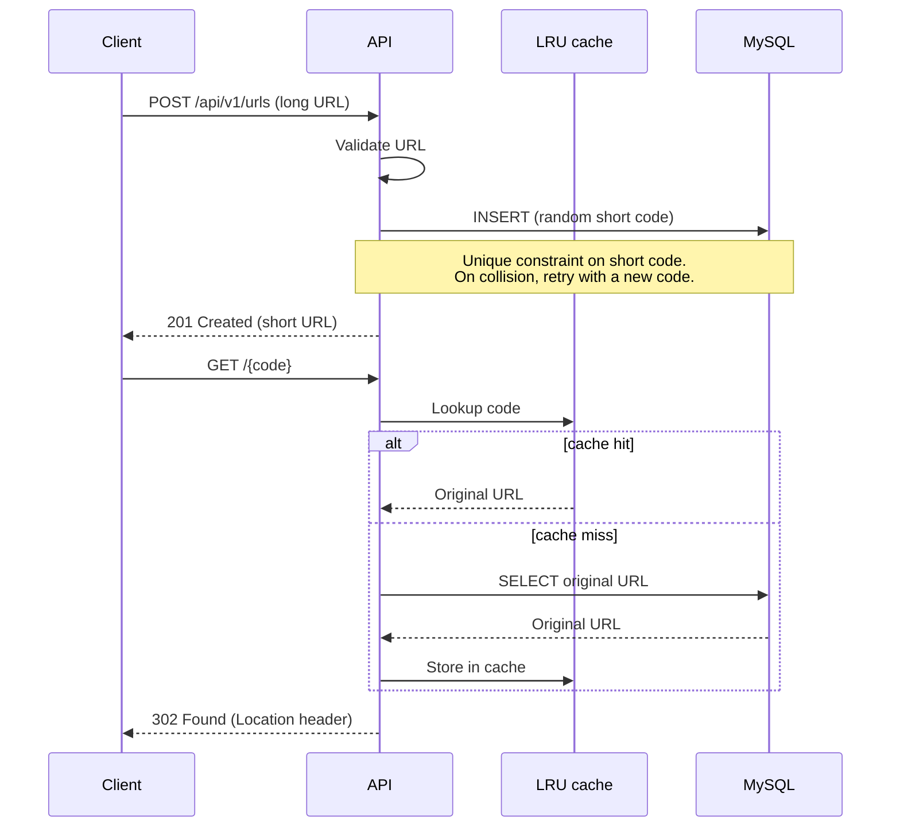

# URL Shortener

[](https://github.com/RamlaHussain458/url-shortener-aws/actions/workflows/ci.yml)


A secure URL shortener built with Spring Boot and MySQL. It turns long URLs into short links and redirects visitors to the original address.

The application is intentionally small. The goal of this project is to take a compact service through a full engineering lifecycle: clean design, security, automated tests, containers, CI, and (in progress) infrastructure as code and deployment on AWS within a student free tier budget.

## Table of contents

- [Features](#features)
- [Architecture](#architecture)
- [Tech stack](#tech-stack)
- [Getting started](#getting-started)
- [API reference](#api-reference)
- [Configuration](#configuration)
- [Testing](#testing)
- [Design decisions](#design-decisions)
- [Security](#security)
- [Project structure](#project-structure)
- [Known limitations](#known-limitations)
- [Roadmap](#roadmap)

## Features

- Create a short link from any public http or https URL
- Fast redirects with an in-memory LRU cache in front of the database
- Unguessable 7 character Base62 codes (about 3.5 trillion combinations)
- Safe by default: URL validation, per-IP rate limiting, security headers, deny-by-default access rules
- Consistent JSON error responses (RFC 9457 problem details)
- Database schema versioned with Flyway migrations
- Automated unit and integration tests, run against a real MySQL with Testcontainers
- Hardened Docker image (multi-stage build, non-root user, read-only filesystem)
- GitHub Actions pipeline that builds and tests every push and pull request

## Architecture

Request flow inside the application:


How a link is created and resolved:



## Tech stack

| Area | Technology |
| --- | --- |
| Language and framework | Java 21, Spring Boot 4.0 |
| Database | MySQL 8.4, schema managed with Flyway |
| Security | Spring Security (stateless), Bean Validation |
| Containers | Docker (multi-stage build), Docker Compose |
| Testing | JUnit 5, Mockito, AssertJ, Testcontainers |
| CI | GitHub Actions |
| Planned | Terraform, AWS (EC2, RDS, ECR, CloudWatch), React frontend |

## Getting started

### Prerequisites

- Docker Desktop (or Docker Engine with the Compose plugin)
- Git
- JDK 21 and Maven, only if you want to run the application outside Docker

### 1. Clone the repository

```bash
git clone https://github.com/RamlaHussain458/url-shortener-aws.git
cd url-shortener-aws
```

### 2. Create your environment file

In the repository root (next to `docker-compose.yml`), create a file named `.env` and paste in the following:

```properties
DB_NAME=urlshortener
DB_USER=urlshortener
DB_PASSWORD=change-me
DB_ROOT_PASSWORD=change-me-too
APP_BASE_URL=http://localhost:8080
```

| Variable | Required | What it is |
| --- | --- | --- |
| `DB_NAME` | Yes (Docker) | Name of the MySQL database to create |
| `DB_USER` | Yes (Docker) | Application database user |
| `DB_PASSWORD` | Yes | Password for that user. The application refuses to start without it |
| `DB_ROOT_PASSWORD` | Yes (Docker) | MySQL root password for the database container |
| `APP_BASE_URL` | No | Base address used to build the returned short URLs |

Change both passwords to your own values. Use only letters, numbers and dashes in the values. The `.env` file is ignored by Git and must never be committed. See [Configuration](#configuration) for every available option.

### 3. Start everything with Docker

```bash
docker compose up --build
```

The API is now available at `http://localhost:8080`.

### 4. Try it

Create a short link (PowerShell):

```powershell
Invoke-RestMethod -Method Post -Uri http://localhost:8080/api/v1/urls -ContentType "application/json" -Body '{"url":"https://example.com/hello"}'
```

Or with curl (macOS, Linux, Git Bash):

```bash
curl -X POST http://localhost:8080/api/v1/urls \
  -H "Content-Type: application/json" \
  -d '{"url":"https://example.com/hello"}'
```

Example response:

```json
{
  "shortCode": "aB3dE9x",
  "shortUrl": "http://localhost:8080/aB3dE9x",
  "originalUrl": "https://example.com/hello"
}
```

Open the `shortUrl` in a browser and you are redirected to the original address.

Stop the containers with `docker compose down`. Add `-v` to also delete the database data.

### Running locally for development

Start only the database. It is published on port 3307 so it does not clash with a MySQL installed on your machine:

```bash
docker compose up -d db
```

Then run `UrlShortenerApplication` from your IDE, or from the command line:

```bash
cd backend
mvn spring-boot:run
```

The application reads the same `.env` file from the repository root, so no extra setup is needed.

## API reference

| Method | Path | Description | Success | Errors |
| --- | --- | --- | --- | --- |
| POST | `/api/v1/urls` | Create a short link. Body: `{"url": "https://..."}` | 201 Created | 400 invalid URL, 429 rate limited, 503 could not generate a code |
| GET | `/{code}` | Redirect to the original URL | 302 Found | 404 unknown code, 429 rate limited |
| GET | `/actuator/health` | Health check | 200 OK | |

All other paths, including other actuator endpoints, are denied.

Errors use the RFC 9457 problem JSON format, for example:

```json
{
  "type": "about:blank",
  "title": "Invalid request",
  "status": 400,
  "detail": "Request validation failed",
  "errors": {
    "url": "must be a valid public http or https URL"
  }
}
```

Rate limited responses include a `Retry-After` header.

## Configuration

Settings are read from environment variables, or from the `.env` file when running locally.

| Variable | Required | Default | Description |
| --- | --- | --- | --- |
| `DB_PASSWORD` | Yes | none | Database password. The application refuses to start without it |
| `DB_USER` | No | `urlshortener` | Database user |
| `DB_NAME` | No | `urlshortener` | Database name |
| `DB_URL` | No | `jdbc:mysql://localhost:3307/<DB_NAME>` | Full JDBC URL. Set automatically by Docker Compose |
| `APP_BASE_URL` | No | `http://localhost:8080` | Base address used to build the returned short URLs |
| `FORWARD_HEADERS_STRATEGY` | No | `none` | Set to `native` behind a trusted reverse proxy so client IPs are read from `X-Forwarded-For` |
| `DB_ROOT_PASSWORD` | Docker only | none | MySQL root password used by the database container |

Tunable application settings (code length, cache size, rate limits) live in `backend/src/main/resources/application.yml` under the `app` section. Default rate limits per client IP:

| Operation | Burst | Sustained rate |
| --- | --- | --- |
| Create a link | 10 requests | 12 per minute |
| Redirect | 120 requests | 120 per minute |

## Testing

```bash
cd backend
mvn verify
```

- Unit tests cover the code generator, LRU cache, rate limiter, URL validator and the service logic (including collision retries).
- Integration tests start a real MySQL 8.4 container with Testcontainers and test the API end to end: creating and resolving links, validation errors, security headers, rate limiting and database constraints.
- Docker must be running for the integration tests. Without Docker they are skipped.

The same build runs automatically on GitHub Actions for every push and pull request.

## Design decisions

### Design patterns

| Pattern | Where | Why |
| --- | --- | --- |
| Strategy | `ShortCodeGenerator` and `Base62ShortCodeGenerator` | Swap the code generation algorithm without touching other code |
| Decorator | `CachedUrlLookup` wraps `RepositoryUrlLookup` | Add caching without changing the database lookup |
| Repository | `UrlMappingRepository` | Keep persistence details out of business logic |
| Chain of Responsibility | `RateLimitFilter` in the security filter chain | Reject abusive traffic before it reaches a controller |
| DTO | `CreateUrlRequest`, `CreateUrlResponse` (Java records) | API contract is separate from the database entity |
| Dependency Injection | Constructor injection throughout | Simple to test and to replace parts |

### Data structures and algorithms

| Item | Detail |
| --- | --- |
| LRU cache | `LruCache`: hash table plus doubly linked list, O(1) get, put and eviction. Misses are not cached, so random probing cannot push popular links out |
| Token bucket | `TokenBucketRateLimiter`: allows short bursts while enforcing an average rate, O(1) per request. Buckets are kept in the LRU cache so memory stays bounded |
| Base62 codes | 7 characters from `0-9A-Za-z` give 62^7, about 3.5 trillion codes |
| Collision handling | Insert and rely on the database unique constraint, then retry with a new code. There is no check-then-insert race condition |

### Why random codes instead of a counter

A counter is simple, but it makes links guessable and lets anyone enumerate every URL in the system. Random codes from `SecureRandom` cannot be predicted. The cost is a tiny chance of collision, which the unique index and the retry loop handle.

### Why 302 instead of 301

A 301 redirect is cached by browsers permanently, which would make features such as click counting or link expiry impossible later.

## Security

- **Input validation:** only http and https URLs, no embedded credentials, no localhost, single-label hosts, private or reserved IP ranges, no IPv6 literals, maximum 2048 characters
- **Access control:** stateless API with deny-by-default authorization. CSRF protection is disabled because there are no sessions or cookies to protect
- **Security headers:** Content-Security-Policy, X-Frame-Options, X-Content-Type-Options, Referrer-Policy and HSTS
- **Rate limiting:** per-IP token buckets, with a much stricter budget for creating links
- **Error handling:** generic error responses, with no stack traces or SQL details leaked
- **Database:** parameterized queries only, case sensitive short codes enforced by the column collation, schema validated at startup
- **Secrets:** read from environment variables or an ignored `.env` file. The application will not start without a database password
- **Containers:** multi-stage build, non-root user, read-only filesystem, all Linux capabilities dropped, database port bound to localhost only

## Project structure

```
url-shortener-aws/
  backend/                      Spring Boot application
    src/main/java/.../
      config/                   Typed properties, security and bean wiring
      controller/               REST controllers (create and redirect)
      service/                  Business logic
      codegen/                  Short code generation (strategy)
      lookup/                   Database lookup and caching decorator
      datastructure/            LRU cache and token bucket rate limiter
      security/                 Rate limiting filter
      validation/               Safe URL validation
      domain/, repository/      JPA entity and repository
      dto/, exception/          API models and central error handling
    src/main/resources/         application.yml and Flyway migrations
    src/test/                   Unit and integration tests
    Dockerfile
  infra/                        Terraform (planned)
  docs/                         Diagrams and notes
  docker-compose.yml            Application and MySQL for local use
  .github/workflows/ci.yml      Build and test pipeline
```

## Known limitations

- The LRU cache and the rate limiter live in the memory of one application instance. Running several instances would need a shared store such as Redis
- No user accounts, custom aliases or link deletion yet
- Internationalized domain names must be entered in their ASCII (punycode) form

## Roadmap

- [x] REST API with validation, error handling and Flyway migrations
- [x] LRU cache, rate limiting and security hardening
- [x] Unit and integration tests with Testcontainers
- [x] Dockerfile and Docker Compose setup
- [x] CI pipeline with GitHub Actions
- [ ] Terraform: VPC, EC2, ECR, IAM and remote state in S3
- [ ] Deploy to AWS with GitHub Actions using OIDC (no stored AWS keys)
- [ ] Monitoring with CloudWatch logs and alarms
- [ ] Click analytics and link expiry
- [ ] Redis cache with a JMeter before and after comparison
- [ ] React frontend served through Nginx
- [ ] Architecture diagram and demo screenshots

## Author

Ramla ([@RamlaHussain458](https://github.com/RamlaHussain458))