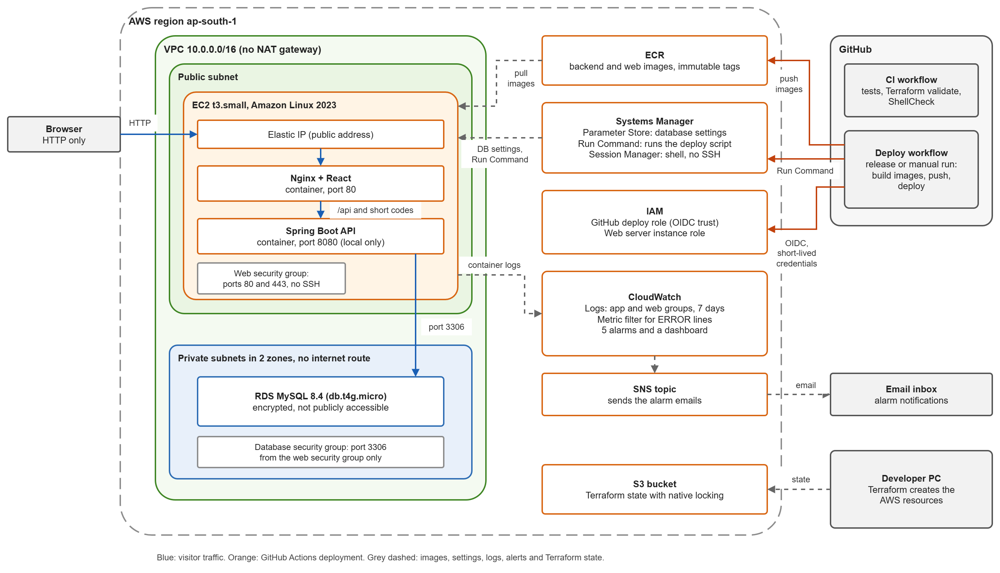
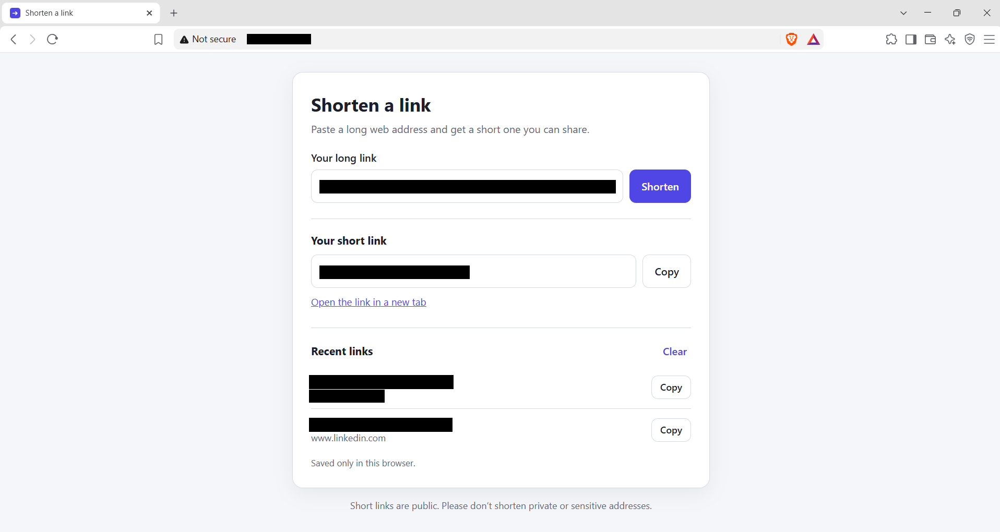
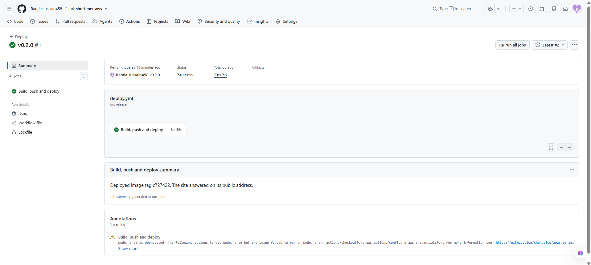
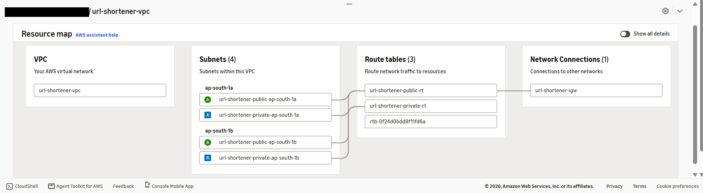
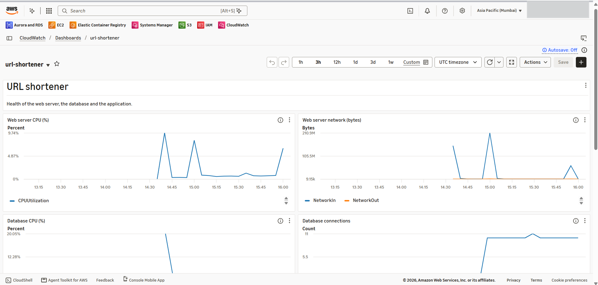
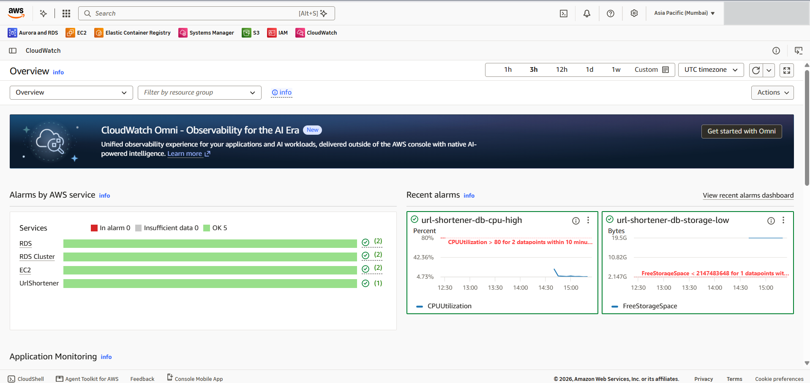
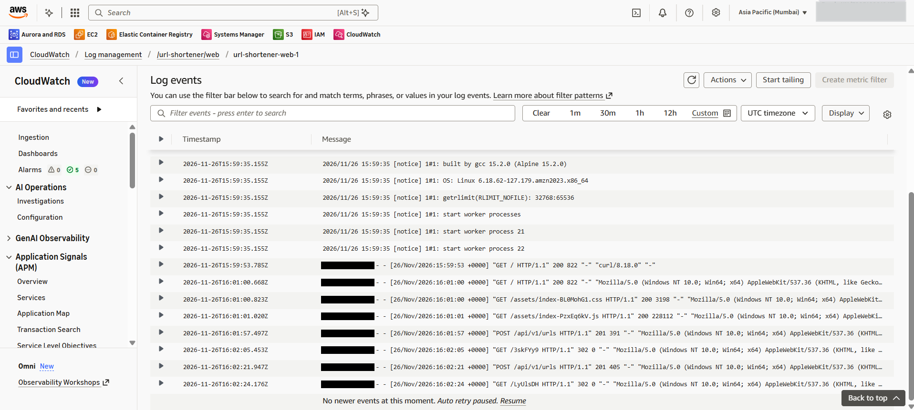
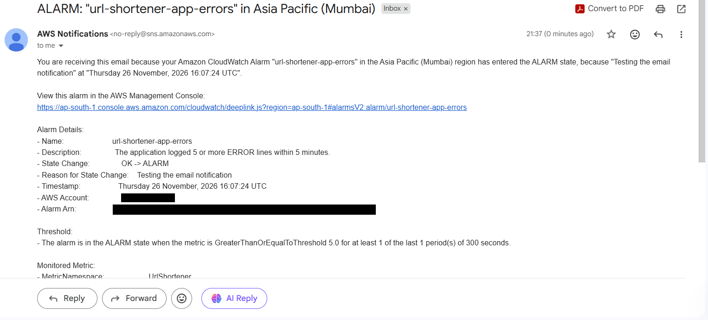

# AWS deployment

This document explains how the URL shortener runs on AWS: what each component is, how a request and a deployment flow through the system, how it is secured and monitored, how I keep the cost down, and what the design does not do. It describes what exists in this repository. Where something is only planned or was not tested, it says so.

**Status.** The stack is created on demand for work sessions and destroyed afterwards, so there is no permanent public URL. It was deployed by the pipeline for v0.2.0, and monitoring was added and verified in v0.3.0. The site is served over HTTP only.

For the step-by-step runbook see [`deployment.md`](deployment.md). For the monitoring details see [`monitoring.md`](monitoring.md). For the reasoning behind each choice see the [architecture decision records](adr).

## Contents

- [Architecture](#architecture)
- [Components](#components)
- [How a visitor request flows](#how-a-visitor-request-flows)
- [How a deployment works](#how-a-deployment-works)
- [How the infrastructure is provisioned](#how-the-infrastructure-is-provisioned)
- [Security design](#security-design)
- [Monitoring](#monitoring)
- [Cost control](#cost-control)
- [Session routine](#session-routine)
- [Evidence](#evidence)
- [Honest limitations](#honest-limitations)
- [What I would improve for production](#what-i-would-improve-for-production)

## Architecture



The editable source is [`architecture.drawio`](architecture.drawio). Blue arrows are visitor traffic, orange arrows are the GitHub Actions deployment, and grey dashed arrows are image pulls, settings, logs, alerts and Terraform state.

## Components

Everything below is defined in Terraform under [`infra/`](../infra), in the region `ap-south-1` (Mumbai).

| Component | What it is | Key settings | File |
|---|---|---|---|
| VPC | One private network, `10.0.0.0/16` | Two public and two private subnets across two availability zones. One internet gateway. **No NAT gateway** | `network.tf` |
| Public subnets | Hold the web server | Route to the internet gateway | `network.tf` |
| Private subnets | Hold the database | **No route to or from the internet** | `network.tf` |
| EC2 instance | The web server | `t3.small`, Amazon Linux 2023, 20 GiB encrypted gp3 disk, IMDSv2 required, 1 GiB swap file, no SSH | `compute.tf`, `user_data.sh` |
| Elastic IP | A fixed public address for the server | Attached to the instance | `compute.tf` |
| Docker Compose | Runs two containers on the server | Nginx with the React app on port 80, Spring Boot API on `127.0.0.1:8080` | `deploy/docker-compose.prod.yml` |
| RDS MySQL | The database | MySQL 8.4, `db.t4g.micro`, 20 GiB gp3, encrypted, **not publicly accessible**, single AZ | `database.tf` |
| Security groups | Firewalls | Web: inbound 80 and 443. Database: inbound 3306 from the web group only. The default group has no rules | `security_groups.tf` |
| ECR | Two image repositories (`backend`, `web`) | Immutable tags, scan on push, only the 5 newest images kept | `ecr.tf` |
| SSM Parameter Store | Database settings | Host, name and user as plain strings, password as an encrypted `SecureString` | `secrets.tf` |
| Systems Manager | Run Command and Session Manager | Deploys without SSH and gives shell access without opening a port | `iam.tf` |
| IAM roles | Permissions | A web server role and a GitHub deploy role (see [Security design](#security-design)) | `iam.tf`, `github_oidc.tf` |
| CloudWatch | Logs, metric filter, alarms, dashboard | Two log groups, kept 7 days. Five alarms. One dashboard | `monitoring.tf` |
| SNS | Delivers alarm emails | One topic with one email subscription | `monitoring.tf` |
| S3 | Terraform state | Encrypted, versioned, public access blocked, native state locking | `backend.tf` |

Why the design looks like this (one small server instead of a load balancer, Fargate or a NAT gateway): the account runs on a credit-based plan, so every always-on service had to justify its cost. See [ADR 0003](adr/0003-free-tier-aws-architecture.md), [ADR 0007](adr/0007-network-design.md) and [ADR 0008](adr/0008-compute-database-and-secrets.md).

One consequence of having no NAT gateway: the server sits in a public subnet with a public address, because it must reach ECR, Parameter Store, GitHub and package repositories itself. The database is the part that is truly isolated.

## How a visitor request flows

1. The browser sends an HTTP request to the Elastic IP on port 80.
2. The web security group allows it. Nginx, running in a container, answers.
3. For the web page and its assets, Nginx serves the React build.
4. For `/api` calls and short codes, Nginx forwards the request to the Spring Boot container and sets `X-Forwarded-For` to the visitor's address, which the rate limiter uses.
5. The API checks its in-memory cache. On a miss, it queries MySQL on port 3306. The database security group accepts that connection only because it comes from the web security group.
6. The API answers. For a short code, that is a `302` redirect to the original URL.

The API container is published only on `127.0.0.1:8080`, so it is not reachable from outside the server. The deploy script uses that port for its health check.

## How a deployment works

The **Deploy** workflow ([`deploy.yml`](../.github/workflows/deploy.yml)) runs when a release is published, or when started by hand from the Actions tab. Only one deploy runs at a time (a `concurrency` group), and a running deploy is never cancelled halfway.

1. **Sign in with OIDC.** The job asks GitHub for a short-lived identity token and exchanges it for temporary AWS credentials by assuming the deploy role. No AWS access keys are stored in GitHub. The one repository secret, `AWS_DEPLOY_ROLE_ARN`, only names the role to assume.
2. **Build and push images.** The job builds the backend and web images and tags both with the first 7 characters of the Git commit. If an image with that tag already exists in ECR, it skips the build, which matches the immutable tags.
3. **Find the server.** The job looks for running instances named `url-shortener-web`. It continues only if there is exactly one. Otherwise it stops with a message to run `terraform apply` and wait.
4. **Run the deploy script through Systems Manager.** The job sends a Run Command that downloads `deploy/deploy.sh` from this exact commit and runs it with the image tag. No SSH connection is involved. The job waits up to about 10 minutes for the result and prints the server's output.
5. **On the server, `deploy.sh`:**
   - downloads `docker-compose.prod.yml` from the same commit
   - reads the database settings from Parameter Store (the server's role allows only `/url-shortener/*`)
   - writes them to `/opt/url-shortener/.env`, readable by root only
   - asks the instance metadata service (IMDSv2) for its public address
   - logs in to ECR, pulls the images, runs `docker compose up -d`, then logs out of ECR
   - waits up to about 3 minutes for `http://127.0.0.1:8080/actuator/health` to report `UP`
6. **Final check.** The workflow requests `http://<public ip>/` from the runner. If the site answers, it writes the deployed image tag to the run summary.

Running `terraform apply` does **not** deploy the application. It creates the server, which is then empty. A deployment is always a separate step.

## How the infrastructure is provisioned

| File | Contents |
|---|---|
| `versions.tf`, `backend.tf`, `providers.tf` | Terraform and provider versions, S3 state with native locking, default tags (`Project`, `ManagedBy`) |
| `variables.tf`, `monitoring_variables.tf`, `outputs.tf` | Inputs and outputs |
| `network.tf`, `security_groups.tf` | VPC, subnets, routes, firewalls |
| `compute.tf`, `user_data.sh` | The server, the Elastic IP and the first-boot script (installs Docker and Compose, adds swap) |
| `database.tf`, `secrets.tf` | RDS, a generated password, Parameter Store entries |
| `ecr.tf` | Image repositories and the cleanup policy |
| `iam.tf`, `github_oidc.tf` | The web server role and the GitHub OIDC trust and deploy role |
| `monitoring.tf`, `dashboard.json.tftpl` | Log groups, metric filter, alarms, SNS, dashboard |

The state lives in an encrypted S3 bucket with native locking, so no DynamoDB table is needed ([ADR 0006](adr/0006-terraform-remote-state-in-s3.md)). CI runs `terraform fmt -check` and `terraform validate` on every pull request. It does not run `terraform plan` or `apply`, because CI has no AWS access. I run those by hand.

## Security design

| Area | What is in place | Where |
|---|---|---|
| No stored AWS keys | GitHub Actions uses OIDC and short-lived credentials | `github_oidc.tf` |
| Narrow trust | The deploy role can be assumed only by this repository, and only from the `main` branch or tags starting with `v` | `github_oidc.tf` |
| Narrow deploy permissions | Push to the two ECR repositories only. Run Command only with the `AWS-RunShellScript` document and only on instances tagged `Project=url-shortener` | `github_oidc.tf` |
| Narrow server permissions | Pull from the two repositories, read parameters under `/url-shortener/*`, write to the two log groups, plus the standard Systems Manager agent policy | `iam.tf`, `monitoring.tf` |
| No SSH | No port 22 rule exists. Shell access is Session Manager | `security_groups.tf` |
| Metadata protection | IMDSv2 is required and the hop limit is 1, which is meant to stop containers from reading the server's credentials | `compute.tf` |
| Network isolation | The database is in private subnets with no internet route, is not publicly accessible, and accepts only the web security group | `network.tf`, `database.tf`, `security_groups.tf` |
| Encryption at rest | Encrypted server disk, encrypted RDS storage, encrypted state bucket, encrypted `SecureString` password | `compute.tf`, `database.tf`, `secrets.tf`, `backend.tf` |
| Secrets | The database password is generated by Terraform, never typed by hand and never committed. On the server it lives in a root-only file | `secrets.tf`, `deploy.sh` |
| Image supply chain | Immutable tags, scan on push, tags tied to the Git commit | `ecr.tf`, `deploy.yml` |
| Container hardening | Non-root users and all Linux capabilities dropped on both containers. Read-only filesystem on the API container | `docker-compose.prod.yml` |
| Application layer | URL validation, per-IP rate limiting, security headers, deny-by-default access rules (see the main README) | `backend/` |

Port 443 is allowed by the web security group, but nothing listens on it, because there is no certificate yet.

## Monitoring

CloudWatch collects everything with no extra servers and no change to the application. See [`monitoring.md`](monitoring.md) for the details.

| What | How |
|---|---|
| Container logs | The Docker `awslogs` driver sends both containers' logs to `/url-shortener/app` and `/url-shortener/web`, kept for 7 days |
| Application errors | A metric filter counts log lines containing `ERROR` |
| Alarms | Server status check failed. Server CPU above 80 percent for 10 minutes. Database CPU above 80 percent for 10 minutes. Database free storage below 2 GiB. 5 or more application errors in 5 minutes |
| Notifications | All five alarms send an email through SNS, both when they fire and when they recover |
| Dashboard | Server CPU and network, database CPU, connections and free storage, the error count and the latest application log lines |

Missing data counts as "not breaching", so an alarm does not fire just because the server is destroyed.

## Cost control

The account is on a credit-based plan, so cost is treated as a design constraint, with a budget alert as a safety net.

While the server, the database and the public address exist, they cost roughly $1.30 a day. That is my own estimate for this setup, not an AWS quote. So I create them only for a work session and remove them afterwards:

```powershell
terraform destroy -target="aws_instance.web" -target="aws_eip.web" -target="aws_db_instance.main"
```

Terraform also removes everything that depends on those three, 10 resources in total: the server, the Elastic IP and its association, the database, the `db_host` parameter, the dashboard, and the four alarms that point at the server or database. The next `terraform apply` recreates them.

These stay: the network, security groups, ECR repositories and their images, IAM roles, log groups, the SNS topic and subscription (so there is nothing to confirm again), the application error alarm, the other three parameters, and the S3 state bucket. I have not measured what these cost separately. I expect it to be small, and I check Cost Explorer to confirm nothing larger is running.

Two things to know about this routine:

- **The data is deleted with the database.** The database has no final snapshot and a 1-day automated backup that disappears with the instance. Links created in one session do not exist in the next. That is acceptable for a demo and would not be for a real service.
- **A targeted destroy is not a teardown.** At the end of the project I plan to run a full `terraform destroy`, delete the state bucket by hand, delete the IAM access keys, and confirm in Cost Explorer that nothing is running.

## Session routine

All commands run in PowerShell, in `infra/`, with the `urlshortener` AWS profile.

1. **Create:** `terraform apply`. Expect a plan of about 10 new resources if only the server side was destroyed. Review it, then confirm.
2. **Wait** a few minutes until the server has installed Docker and registered with Systems Manager. Check with:

   ```powershell
   aws ssm describe-instance-information --region ap-south-1 --query "InstanceInformationList[].[InstanceId,PingStatus]" --output table
   ```

   You should see one instance with `Online`.
3. **Deploy:** in GitHub, open Actions, choose **Deploy**, and run it on `main` (or publish a release). A successful run ends with a summary naming the image tag.
4. **Test:** open `http://<web_public_ip>` (`terraform output web_public_ip`), create a short link and follow it. Type `http://` explicitly, because a browser may try HTTPS first. To check from the command line, use `curl.exe -I http://<ip>`, because plain `curl` in PowerShell 5.1 is an alias for another command.
5. **Destroy:** run the targeted destroy above, review the plan, confirm, and check the EC2, Elastic IP and RDS pages for the region are empty.

## Evidence

These screenshots come from real deployments (v0.2.0 and v0.3.0). Account identifiers, IP addresses and test links are covered.



*The app on the EC2 instance. The browser warns "Not secure" because the site is HTTP only.*



*A successful Deploy run for v0.2.0.*



*Two public and two private subnets, one internet gateway, no NAT gateway.*



*The dashboard with server and database metrics.*



*All five alarms in the OK state.*



*Nginx access logs delivered by the `awslogs` driver.*



*An alarm email through SNS. I triggered the application error alarm by hand to test the path.*

What the evidence does and does not cover: it shows a working deployment, the network layout, the dashboard, the alarms in the OK state, container logs, and one alarm email. I have no evidence of the other four alarms actually firing. Their thresholds are configured but were not triggered.

## Honest limitations

- **HTTP only.** No domain and no certificate, so traffic is not encrypted in transit and browsers show "Not secure".
- **Single server, single database.** No load balancer, no failover, no second availability zone. A deployment briefly restarts the containers.
- **Data does not survive a session.** See [Cost control](#cost-control).
- **The application uses the database's main account.** The same user that Terraform creates as the RDS administrator is used by the API. A separate account with only the permissions it needs would be better.
- **The JDBC connection does not force TLS.** The URL has no setting that requires encryption between the server and the database, and I have not verified what is negotiated.
- **The database password is also in the Terraform state.** That is how the generated password reaches RDS. The bucket is encrypted, versioned and set up to block public access (see the commands in [`infra/README.md`](../infra/README.md)), but anyone with access to the state can read the password.
- **First boot trusts the internet.** `user_data.sh` installs Docker from the package repository and downloads the Compose plugin from GitHub releases without verifying a checksum. The deploy script downloads the Compose file and itself from GitHub at a specific commit, which works because the repository is public.
- **Outbound traffic is unrestricted.** The web security group allows all outbound traffic, because there is no NAT gateway or VPC endpoint to narrow it.
- **Wide read permissions where AWS requires them.** `ec2:DescribeInstances`, the ECR login token and reading command results use `*` as the resource. AWS does not support narrower scoping for those actions.
- **Limited monitoring.** There are no memory or disk metrics for the server, because that needs the CloudWatch agent. CPU and database storage alarms were configured but not triggered.
- **The Nginx container is not read-only.** Only the API container has a read-only filesystem.
- **No automated infrastructure changes.** CI validates Terraform but never applies it. Infrastructure changes are manual.
- **Manual testing only after deploy.** The deploy checks the health endpoint and the home page. There are no automated end-to-end tests against the live environment.

## What I would improve for production

1. **HTTPS.** Add a domain name and a certificate (CloudFront or an Application Load Balancer with ACM). This also enables the browser's native Clipboard API.
2. **Remove the single points of failure.** A load balancer, a multi-AZ database and a container platform such as ECS Fargate, with the server tier in private subnets behind the load balancer.
3. **Least-privilege database access.** A separate application user, TLS required, and the database password handled by AWS Secrets Manager with rotation.
4. **Safer first boot.** Build a machine image with Docker already installed, and verify checksums for anything downloaded.
5. **Review infrastructure changes.** Run `terraform plan` on pull requests with a read-only role, and require approval before `apply`.
6. **Deployment safety.** Blue/green or rolling deployments, an approval step for production, and automated smoke tests after each deploy.
7. **Better observability.** The CloudWatch agent for memory and disk, application metrics with Prometheus and Grafana, and alarms that cover the user-facing error rate.
8. **Backups and recovery.** Longer backup retention, a final snapshot on delete, and a tested restore.
9. **Network tightening.** VPC endpoints or a NAT gateway so the server can sit in a private subnet and outbound traffic can be restricted.
